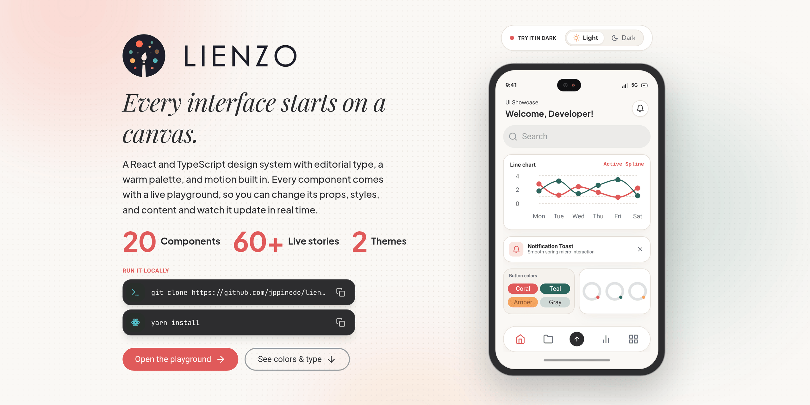
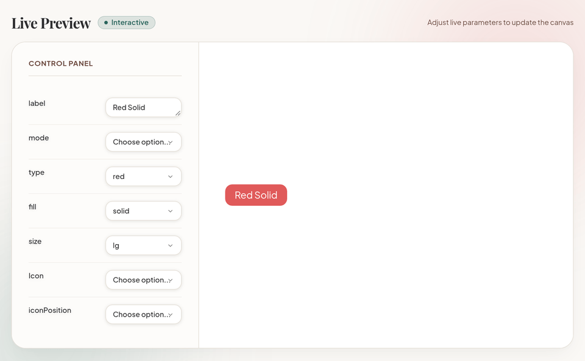
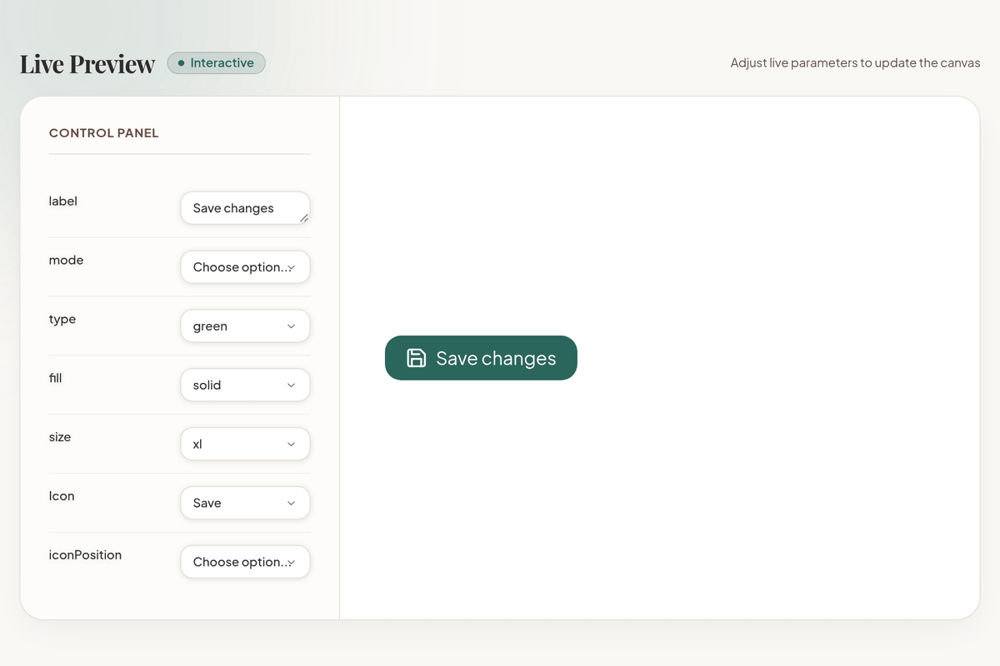
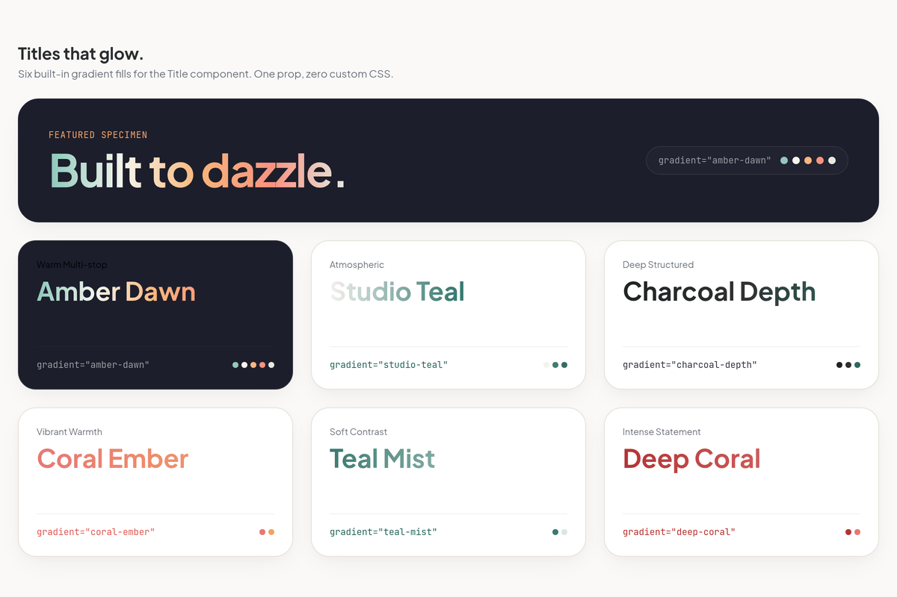
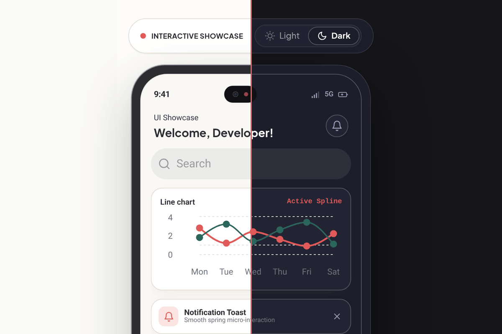
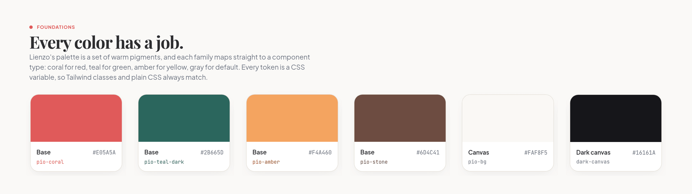
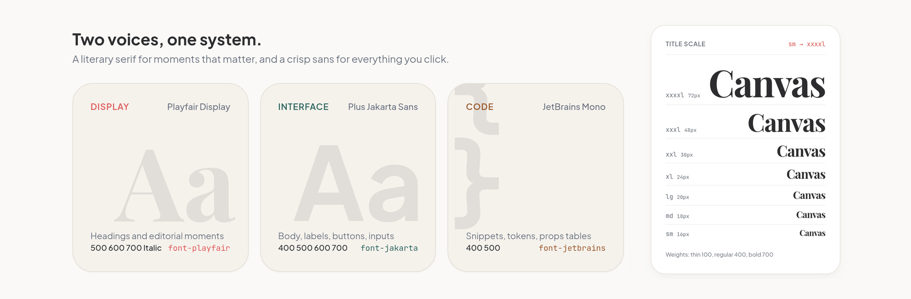

<!-- Images live in .github/assets/readme/ -->
<p align="center">
  <a href="https://lienzo.pinedo.cl">
    <picture>
      <source media="(prefers-color-scheme: dark)" srcset=".github/assets/readme/banner-dark.png">
      
    </picture>
  </a>
</p>

<h3 align="center">Every interface starts on a canvas.</h3>

<p align="center">
  A React and TypeScript design system with editorial type, a warm palette, and motion built in.<br>
  Every component ships with a live playground, so you can change its props, styles, and content and watch it update in real time.
</p>

<p align="center">
  <a href="https://lienzo.pinedo.cl"><strong>Open the playground</strong></a> ·
  <a href="Documentation/index.md"><strong>Read the docs</strong></a> ·
  <a href="CONTRIBUTING.md"><strong>Contribute</strong></a>
</p>

<p align="center">
  <a href="LICENSE"></a>
  <a href="https://github.com/jppinedo/lienzo/actions/workflows/ci.yml"></a>
  <a href="https://lienzo.pinedo.cl"></a>
  <a href="CONTRIBUTING.md"></a>
</p>

---

## Change a prop. Watch it change.

Most component libraries hand you a props table and wish you luck. Lienzo hands you the component itself. Every Docs page has a Live Preview: switch the fill, swap the color, type a new label, add an icon, and the component updates as you go. You find out what it can do in seconds, not after three rounds of copy, paste, and refresh.

<p align="center">
  <a href="https://lienzo.pinedo.cl/?path=/docs/atoms-button--docs">
    <picture>
      <source media="(prefers-color-scheme: dark)" srcset=".github/assets/readme/playground-dark.gif">
      
    </picture>
  </a>
</p>

<p align="center"><a href="https://lienzo.pinedo.cl/?path=/docs/atoms-button--docs">Try it yourself on the Button page →</a></p>

## Why developers pick Lienzo

<table>
  <tr>
    <td width="33%" valign="top">
      <picture>
        <source media="(prefers-color-scheme: dark)" srcset=".github/assets/readme/highlight-playground-dark.png">
        
      </picture>
      <h3>A playground on every page</h3>
      <p>Every atom and molecule documents itself the same way: overview, Live Preview, variations, props, and code you can copy. Learn one page and you know them all.</p>
    </td>
    <td width="33%" valign="top">
      <picture>
        <source media="(prefers-color-scheme: dark)" srcset=".github/assets/readme/highlight-editorial-dark.png">
        
      </picture>
      <h3>A look with a point of view</h3>
      <p>Editorial serif headlines, a warm coral, teal, and amber palette, and gradient titles. Your product won't look like every other default theme.</p>
    </td>
    <td width="33%" valign="top">
      
      <h3>Light and dark, built in</h3>
      <p>One switch flips every component. Dark mode is designed alongside light, not bolted on afterward, so both feel finished.</p>
    </td>
  </tr>
</table>

## Every color has a job.

Colors live as design tokens in [`src/css/tokens.css`](src/css/tokens.css) and map straight into Tailwind CSS 4, so `bg-pio-coral` or `text-pio-teal-dark/80` just work. Change a token once and the whole system follows.

<p align="center">
  <picture>
    <source media="(prefers-color-scheme: dark)" srcset=".github/assets/readme/palette-dark.png">
    
  </picture>
</p>

## Two voices, one system.

Playfair Display brings the personality to headlines. Plus Jakarta Sans keeps the interface clear and friendly. JetBrains Mono handles the code.

<p align="center">
  <picture>
    <source media="(prefers-color-scheme: dark)" srcset=".github/assets/readme/type-dark.png">
    
  </picture>
</p>

## What's inside

**20 components, 60+ live stories, 2 themes**, organized with Atomic Design so you always know where something lives.

| Tier | Components |
|------|------------|
| **Atoms** | [Background](https://lienzo.pinedo.cl/?path=/docs/atoms-background--docs) · [Badge](https://lienzo.pinedo.cl/?path=/docs/atoms-badge--docs) · [Box](https://lienzo.pinedo.cl/?path=/docs/atoms-box--docs) · [Button](https://lienzo.pinedo.cl/?path=/docs/atoms-button--docs) · [Card](https://lienzo.pinedo.cl/?path=/docs/atoms-card--docs) · [Checkbox](https://lienzo.pinedo.cl/?path=/docs/atoms-checkbox--docs) · [CircleSpinner](https://lienzo.pinedo.cl/?path=/docs/atoms-circlespinner--docs) · [Input](https://lienzo.pinedo.cl/?path=/docs/atoms-input--docs) · [Label](https://lienzo.pinedo.cl/?path=/docs/atoms-label--docs) · [Select](https://lienzo.pinedo.cl/?path=/docs/atoms-select--docs) · [Spinner](https://lienzo.pinedo.cl/?path=/docs/atoms-spinner--docs) · [Switch](https://lienzo.pinedo.cl/?path=/docs/atoms-switch--docs) · [Title](https://lienzo.pinedo.cl/?path=/docs/atoms-title--docs) |
| **Molecules** | [Calendar](https://lienzo.pinedo.cl/?path=/docs/molecules-calendar--docs) · [CodeBlock](https://lienzo.pinedo.cl/?path=/docs/molecules-codeblock--docs) · [LineChart](https://lienzo.pinedo.cl/?path=/docs/molecules-linechart--docs) · [Menu](https://lienzo.pinedo.cl/?path=/docs/molecules-menu--docs) · [Tabs](https://lienzo.pinedo.cl/?path=/docs/molecules-tabs--docs) · [Toolbar](https://lienzo.pinedo.cl/?path=/docs/molecules-toolbar--docs) |
| **Templates** | [Phone](https://lienzo.pinedo.cl/?path=/docs/templates-phone--docs) |

Built with **React 19**, **TypeScript 6**, **Tailwind CSS 4**, and **Storybook 10**. Full inventory: [Component structure](Documentation/component-structure.md).

## Run it locally

You need Node 24 (see `.nvmrc`). Corepack, which comes with Node, picks the right Yarn for you.

```bash
git clone https://github.com/jppinedo/lienzo.git
cd lienzo
corepack enable
yarn install
yarn storybook   # opens http://localhost:6006
```

<details>
<summary>More commands and troubleshooting</summary>

```bash
yarn build             # library → dist/ (JS + .d.ts + component CSS)
yarn build-storybook   # static build in storybook-static/
yarn verify            # typecheck + lint + library build + Storybook build (same as CI)
```

On macOS, if you see `EMFILE: too many open files`, run `ulimit -n 10240` and start Storybook again. More in [Getting started](Documentation/getting-started.md).

</details>

## Using Lienzo in your app

Package name: **`@jppinedo/lienzo`**. It is not on npm yet; use a local Yarn portal (or path) link until the first publish.

### 1. Link the package (Yarn 4)

In your app’s `package.json`:

```json
{
  "dependencies": {
    "@jppinedo/lienzo": "portal:../lienzo"
  }
}
```

Adjust the relative path to your Lienzo checkout, then run `yarn install`.

Vite resolves the package `development` condition to `src/index.ts` during `vite` / `vite dev`, so edits in Lienzo hot-reload in the app. Production builds resolve to `dist/` — run `yarn build` in Lienzo before a production consumer build if you are not using the development condition.

### 2. Tailwind CSS 4

In your app’s CSS entry (with `@tailwindcss/vite` or the Tailwind PostCSS plugin):

```css
@import 'tailwindcss';
@import '@jppinedo/lienzo/theme.css';

/* Scan Lienzo for utility class names (portal → package root; published → node_modules). */
@source '../node_modules/@jppinedo/lienzo/src';
```

With a `portal:` link, Yarn places the package under `node_modules/@jppinedo/lienzo`, so the `@source` path above still works. Import component CSS when you need keyframes / non-Tailwind rules from the built bundle:

```ts
import '@jppinedo/lienzo/style.css';
```

(Only required for production/`dist` consumers; in development, component CSS is pulled in via source imports.)

### 3. Import components

```tsx
import { Button, Title } from '@jppinedo/lienzo';

export function Example() {
  return (
    <>
      <Title size="xl" fontFamily="playfair">
        Hello
      </Title>
      <Button label="Save" onClick={() => {}} />
    </>
  );
}
```

### 4. Deduplicate React

`react` and `react-dom` are peer dependencies. Your app must provide a single React 19 tree. If you see invalid hook call / multiple React copies with a portal link, dedupe in the app’s Vite config:

```ts
import { defineConfig } from 'vite';
import path from 'node:path';

export default defineConfig({
  resolve: {
    dedupe: ['react', 'react-dom'],
    alias: {
      react: path.resolve('node_modules/react'),
      'react-dom': path.resolve('node_modules/react-dom'),
    },
  },
});
```

## Come build it with me

Lienzo is young, which means your pull request matters here. You won't be fixing a typo in a giant codebase where nobody notices. You'll be shaping a component people actually see. Issues are small and clearly described, and PRs get reviewed daily.

- 🟢 Start with a [good first issue](https://github.com/jppinedo/lienzo/labels/good%20first%20issue).
- 📖 Read the [contributing guide](CONTRIBUTING.md). It takes about five minutes.
- 💬 Have an idea for a component? [Open an issue](https://github.com/jppinedo/lienzo/issues/new) and let's talk.

New to open source? That's welcome too. Your first PR can be here.

> [!NOTE]
> Lienzo is in early development (v0.1.0) as `@jppinedo/lienzo`. It isn't published to npm yet — use a Yarn `portal:` link (see above), explore the [live playground](https://lienzo.pinedo.cl), or run Storybook locally.

## License

[MIT](LICENSE) © 2026 Juan Pablo Pinedo. Use it, fork it, ship it.

<p align="center"><sub>Made with care by <a href="https://github.com/jppinedo">Juan Pablo Pinedo</a>, one component at a time.</sub></p>
